<p align="center">
  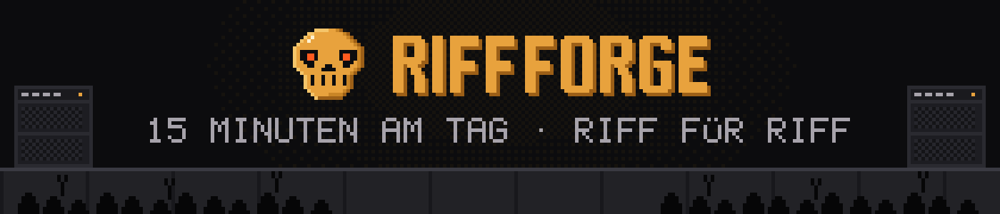
</p>

<p align="center">
  <a href="https://cyphomat.github.io/riffforge/"></a>
  
  <a href="./LICENSE"></a>
  
  
</p>

<p align="center">
  <b>A practice app for one person.</b><br>
  Not a course catalogue, a workbench. Start, play for fifteen minutes, done — again tomorrow.
</p>

<p align="center">
  <sub>100% vibe coded. Use at your own risk. Feature requests welcome.</sub>
</p>

<p align="center">
  <a href="README.md">Deutsch</a> · <b>English</b>
</p>

> **A note on language.** The app's interface is **German only**. The exercises,
> the cues and the daily briefing are instructional text that has to be
> translated by meaning rather than word for word, so it has deliberately not
> been touched yet. This file explains what the app does; the app itself will
> talk to you in German.

---

## Getting started

<h3 align="center">
  <a href="https://cyphomat.github.io/riffforge/">▶ Open Riffforge — cyphomat.github.io/riffforge</a>
</h3>

1. **Open it.** The link above, in a browser. No account, no sign-up, nothing
   to install.
2. **Put it on your home screen** — recommended. iPhone: in **Safari**,
   Share → *Add to Home Screen*. Mac and Android: *Install* in the address
   bar. After that it runs offline, and Safari will not clear your practice
   log after seven days. [More on that](#installing-it-as-an-app)
3. **Play.** Two questions on first launch, then *Session starten*. The
   guitar is enough; the device microphone is optional and, if you allow it,
   measures your timing.

Your data stays in this browser. Backing it up and moving it to another device
is under *Daten*.

---

## What it looks like

<table>
<tr>
<td width="33%">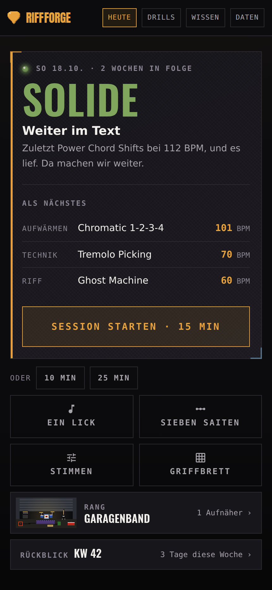</td>
<td width="33%">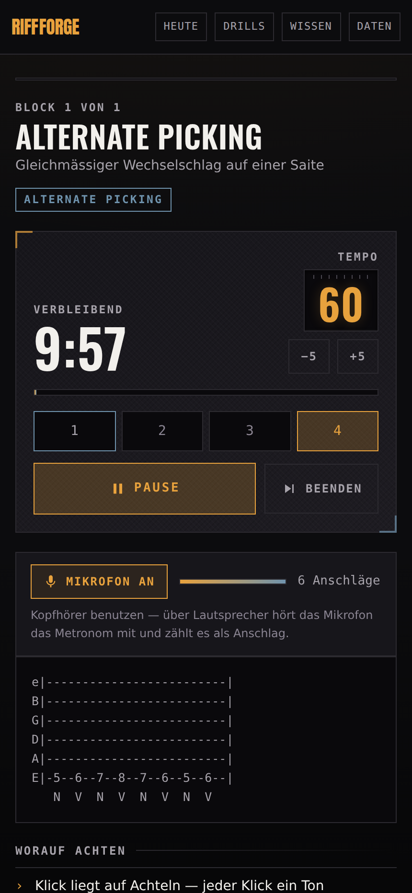</td>
<td width="33%">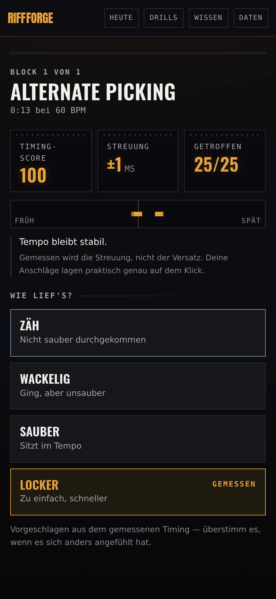</td>
</tr>
<tr>
<td align="center"><b>The briefing</b><br><sub>What today is about, and why</sub></td>
<td align="center"><b>In a block</b><br><sub>Clock, tempo, tab, metronome</sub></td>
<td align="center"><b>Afterwards</b><br><sub>What the microphone heard</sub></td>
</tr>
</table>

**On a Mac it becomes an overview** — briefing, practice calendar, numbers and
tempos side by side instead of stacked:

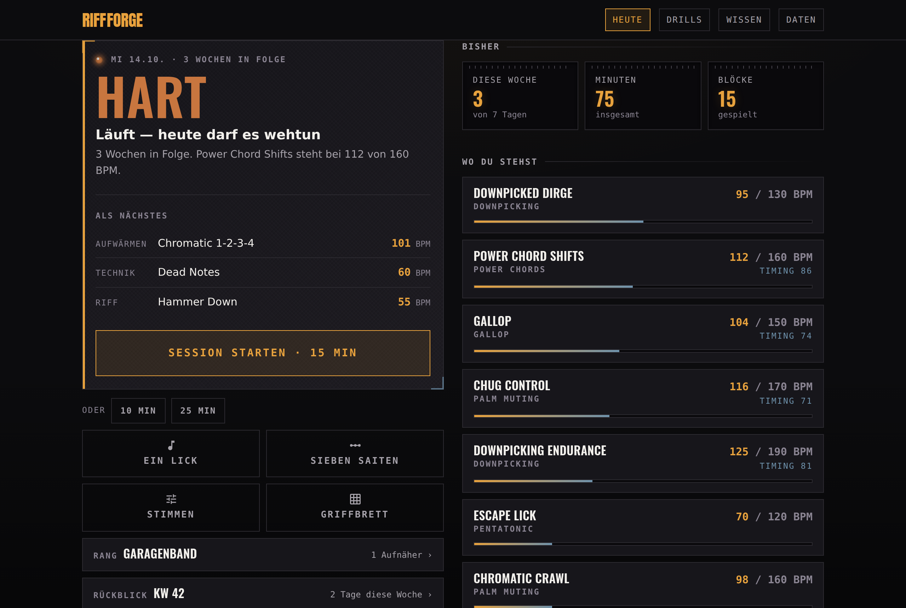

**And inside a block the clock sits next to the tab**, so nothing has to be
scrolled while you play:

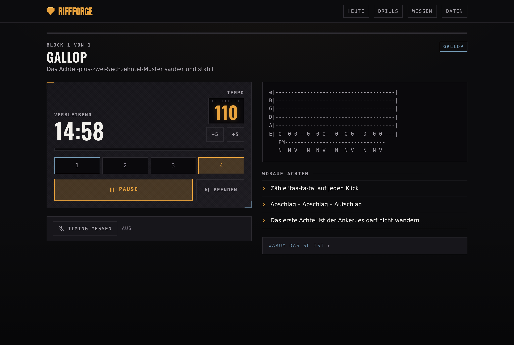

<sub>Real screens with sample data, captured via <code>tools/shots.mjs</code>. No mockups — the timing figures above come from an actual measurement.</sub>

**For daylight there is a light version**, borrowed from Roadie: the same
road case in grey instead of black. Under *Daten → Darstellung* you pick
**Auto**, **Hell** or **Dunkel**; Auto follows the device. The choice
belongs to this browser only and is applied before the first paint, so
nothing flashes. The contrast test checks both versions — amber is much
darker in the light one, otherwise it could not carry text on a light ground.

**A strip at Christmas.** From 1 to 26 December, *Heute* shows a small strip
under the daily call with a pixel Christmas tree and one line; on the days
Lemmy and Ozzy died, a plain candle. No motion, never inside a session, with
a ✕ for the day. *Daten → Saisonales* turns it off entirely. It is the only
decoration in the app and therefore has tight limits
(`docs/design-und-themes.md`).

**A guitar from the rack.** For every technique the session rolls one of your
guitars, and you play the riff that goes with it on the same one; the second
round never lands on the first one's guitar. You keep the rack under
*Daten → Gitarren*; it only applies to this browser. It needs two guitars or
more, and in the seven-string mode it only draws from the seven-strings.

---

## The first launch

<p align="center">
  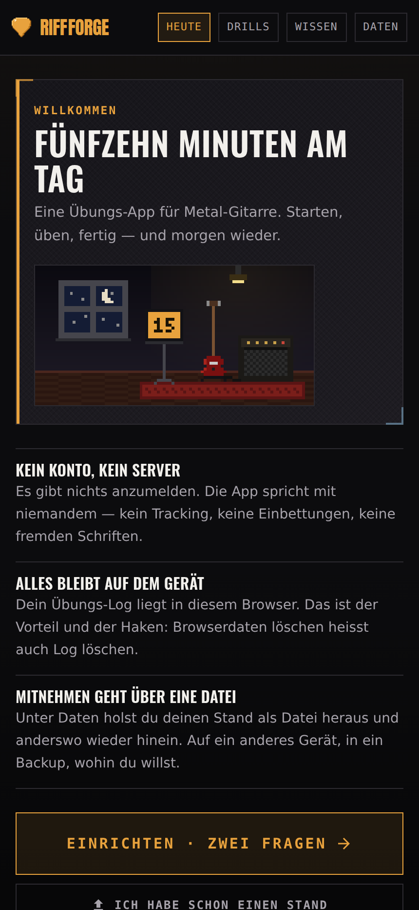
</p>

Before that comes the welcome screen, once, with a practice corner at night as
a pixel picture — the phone on the music stand reads 15 — and the three answers
worth having before the first tap: no account, everything stays on the device,
and it moves via a file.

Two questions, then never again: **where you are** and **what interests you
first**. Both change something real — the first sets the starting tempo of every
drill, the second weights what comes up first.

A focus is a nudge, not a filter: pick lead and you will still get to the
picking hand, just later. And both only affect where you *start* — once there is
a log, the tempo carries itself forward and the answer stops mattering.

## How a session runs

Always the same shape, so it costs no decision:

```
Warm-up     2 min    wake the hands up
Technique  ~3 min    one thing in isolation, with a metronome
Riff       ~3 min    the same technique in a musical context
Technique  ~3 min    second round, with something else in between
Riff       ~3 min    second round
Wrap-up              how did it go — goes into the log
```

Two batches of two knowledge questions sit in the transitions, roughly forty
seconds each. At the end: **call it a day** or **+5 minutes**. The shape is
fixed, the content adapts, and the questions are
[skippable](#inside-a-session) — they never make the session longer.

## What it tells you

The difference from a metronome with tab pictures: it has an opinion about
today — from the log, not from a hunch.

- **The briefing** reads the last session, the running streak and the break
  before it, and picks between `START`, `BREAK`, `TECHNIQUE`, `SOLID` and
  `HARD`. Every line is verifiable in the log:

  > **TECHNIQUE** — Clean today, not fast.
  > *Gallop was shaky at 95 BPM last time. The tempo stays until it sits.*

- **One shaky block outweighs three clean ones.** What does not sit sets the
  tone — not the average.
- **The tempo carries itself forward.** Got through cleanly means faster next
  time, struggled means slower. Shaky means the same tempo again, because that
  is exactly where consolidation happens.
- **What comes up** is chosen by two forces: what sits worst, and what has gone
  longest untouched.
- **A drill you know comes up twice** — with something else in between. That is
  the [contextual interference effect](https://www.ncbi.nlm.nih.gov/pmc/articles/PMC4989027/):
  distributed repetition is retained measurably better than one long block, even
  though it feels worse. And **nothing runs longer than three minutes at a
  stretch**, not even a new drill: six minutes of the same palm-muted chug
  drive you up the wall, and then you are sitting it out rather than practising.
  **+5 minutes** is therefore two different drills of two and a half each.
- **Today is a poster.** The word for the day stands huge and in its colour,
  one sentence under it — and then what comes next, with tempos, and the start
  button in the same card. The plan is rolled once per day: what the poster
  announces is exactly what the session plays.
- **The streak counts weeks, not days.** A week with at least one session keeps
  it alive. A missed evening breaks nothing — regularity is rewarded, not an
  unbroken chain.
- **The achievement first, the report second.** New personal bests sit at the
  top after a session. Below, the session is taped up as a **setlist note**:
  what went clean is crossed out, what was rough carries the stamp *again*, and
  next to each song stands the tempo it continues at next time. The titles are
  in a marker hand — the only handwriting in the app, and only on paper.
- **The practice calendar** sits under *Bisher*, with weekdays and months along
  its edges and, next to it, how many days it was and when you last played. It
  grows with the log, up to sixteen weeks. Deliberately just
  practised or not, with no shading by minutes: a session is around a quarter of
  an hour by construction, so showing the minutes as a colour ramp would be
  dressing up noise as signal. What matters here are streaks and gaps.

## The drills

Twenty of them. The tempo on the right is start → target; where you actually
begin depends on your answer at first launch, and where it goes depends on what
you play. In the app every technique carries its own pixel sign — a flame for
the warm-up, a hand for palm muting, the X of a dead note.

**Warm-up**

| Drill | Technique | Goal | BPM |
|---|---|---|---|
| Chromatic 1-2-3-4 | — | Finger independence, and waking the hand up | 60 → 120 |
| String Skipping | — | Picking hand hits its target without looking | 60 → 130 |

**Technique**

| Drill | Technique | Goal | BPM |
|---|---|---|---|
| Downpicking Endurance | Downpicking | Stamina in pure downstrokes — the core of the thrash sound | 90 → 190 |
| Chug Control | Palm muting | Even palm mutes — every chug the same volume, the same length | 80 → 170 |
| Gallop | Gallop | The eighth-plus-two-sixteenths figure, clean and steady | 70 → 150 |
| Power Chord Shifts | Power chords | Position changes with no gap and no string noise | 70 → 160 |
| Alternate Picking | Alternate picking | Even alternate picking on one string | 60 → 140 |
| Pentatonik Box 1 | Pentatonic | A minor pentatonic in 5th position, up and down | 60 → 150 |
| Bending & Vibrato | Bending | Hit the pitch of a whole-step bend and hold it | 50 → 100 |
| Hammer-on und Pull-off | Legato | Notes made by the fretting hand alone | 55 → 130 |
| Slides | Slides | Position changes in tempo, without losing the note | 55 → 120 |
| Dead Notes | Dead notes | Attacks without pitch — filling the gaps without muddying the sound | 60 → 140 |
| Tremolo Picking | Tremolo | Very fast alternate picking on one string, evenly | 70 → 180 |

**Riff**

| Drill | Technique | Goal | BPM |
|---|---|---|---|
| Ironclad | Gallop | Gallop plus a position change — the first real riff | 70 → 145 |
| Chromatic Crawl | Palm muting | Open chugs against chromatic target notes — timing under pressure | 80 → 160 |
| Downpicked Dirge | Downpicking | Slow, heavy, all downstrokes — timing with nowhere to hide | 60 → 130 |
| Escape Lick | Pentatonic | First lead lick: pentatonic with a bend at the end | 55 → 120 |
| Ghost Machine | Dead notes | Dead notes in a riff — sixteenths where only half of them ring | 60 → 150 |
| Hammer Down | Legato | Legato out of the open string, in a riff | 55 → 130 |
| Lick Forge | Pentatonic | A fresh lead lick from the pentatonic box — stays until you own it | 50 → 130 |
| Three Notes | Pentatonic | Read and play three notes: A, C and D, with half and quarter notes | 50 → 80 |
| Eighth Pendulum | Pentatonic | Eighth notes and rests: an eighth is half a quarter | 60 → 90 |
| Distances | Pentatonic | Hear and read distances: fourth and fifth across several strings | 60 → 100 |
| Two Places | Pentatonic | Positions: the same note in two places, first in position 1, then in position 2 | 50 → 80 |

## One lick

Next to the quarter hour there is a second entrance: **one lick** — the ghost
button under the start button, or `/lick` directly. Three minutes of lead
playing, with no session around it, for when you just feel like it.

The lick is **computed**, not pulled from a list. Rolling dice over the
pentatonic scale would produce note salad, and what you would mostly fail to
learn from it is *phrasing*. So every lick has the same shape — two bars of
4/4 on eighths:

```
Motif        three or four notes with a direction: up, down, arc, zigzag
Development  the same motif repeated, sequenced or inverted
Approach     stepwise towards the target note
Resolution   root or fifth, on beat three, held with vibrato
```

The target note is a stable one, because a lick that stops on the minor third
sounds cut off rather than open.

You can pick **all twelve roots in five positions** — sixty boxes. The picker
names the lowest fret rather than just the position number: "position 3" tells
you nothing under your fingers, "from fret 8" does. The positions run in a
circle, and which one sits lowest depends on the root: in A minor it is
position 4, not position 1.

A lick **stays until you rate it clean** — then the next one comes. It writes
into the same log and under the same drill id as the Lick Forge inside a
session: the generator is the drill, the lick is the content. A tempo curve
across a string of different licks would mean nothing, and neither would two
halves that know nothing about each other.

The microphone only hears the **rhythm** here. Whether the *notes* were right
is something the app cannot know, and it does not claim to —
[pitch detection](#what-is-still-coming) is what would change that.

## Songs

Below the riffs sit four short songs that do not just train a technique but
**reading music**: notes, distances, lengths and positions. Every song has a learning
goal, and the app checks that it trains exactly that — a song that promises
three notes and plays two does not pass the test.

| Song | Notes | Note values | Distances |
|---|---|---|---|
| Three Notes | A C D | Half, quarter | major second, minor third |
| Eighth Pendulum | A C D E | Quarter, eighth, quarter rest | major second, minor third |
| Distances | A C D E G | Half, quarter, eighth | major second up to a fifth |
| Two Places | A C D E G | Half, quarter | major second, minor third, fourth; positions 1 and 2 |

The block shows the notation with the note names, the tab below it, and lets
you listen to the song — with count-in, click and loop, at the tempo of the
block. While you listen, the note that is sounding lights up in the notation.
You can hear how long a note lasts because each one is damped where its
value ends. There is no microphone timing for songs: rests and long notes
would make a correct performance look wrong.

Twelve knowledge cards practise the reading itself: naming a note, the distance
between two notes, how long a note lasts, the value of a rest. The notation sits
in the question, and the answer is calculated from it instead of written next to it.

## Seven strings

A mode of its own for the seven-string — **/sieben**, the second ghost button
on *Heute*. Ten minutes, three blocks from a separate catalog: warm-up,
technique, riff. Deliberately not part of the daily quarter hour, and that is
not a matter of taste: these drills need a different guitar, and a block you
cannot play because it is in its case is a broken plan for the day.

The tuning is **B standard** — `B – E – A – D – G – B – E`. Six strings stay
exactly as they were, the low B is added underneath, a fourth below the low E.
That is the piece of information a switcher is missing: **the fifth fret of the
new string gives you the note your lowest open string used to give.** Every
shape you know still holds, because the interval between two strings is the
same everywhere — except between G and B, as always.

Drop A is deliberately absent: it is a different orientation on the lowest
string, and it would be a second catalog rather than a toggle.

| Drill | Kind | Goal | BPM |
|---|---|---|---|
| Alle Sieben | Warm-up | The picking hand learns that the neck goes on below | 60 → 120 |
| Quartensprung | Warm-up | Hit every other string without looking | 55 → 120 |
| Chug auf B | Technique | Get the low string dry instead of muddy | 70 → 160 |
| Stille auf der Sieben | Technique | Keep the low string silent while you play above it | 55 → 120 |
| Power Chords auf der Sieben | Technique | Root on the lowest string, with no string noise | 60 → 150 |
| Gallop auf B | Technique | The gallop figure down there, without it smearing | 60 → 140 |
| Pentatonik in den Keller | Technique | Extend the familiar box onto the seventh string | 55 → 140 |
| Tieferlegung | Riff | Muted chugs below against ringing power chords | 60 → 140 |
| Wechselbad | Riff | Jump between the lowest string and the middle, without rumble | 55 → 130 |
| Erdgeschoss | Riff | A lead phrase that falls out of the box downwards | 50 → 120 |

The drills go into the **same** practice log as everything else, each with its
own id and its own tempo curve. Only the catalogs are separate, and only for
picking: in the *Drills* library they sit at the bottom on their own and can be
started individually. No knowledge questions here — this is a craft mode, and
what there is to know about the low string sits on the drill itself.

## The merch stand

<p align="center">
  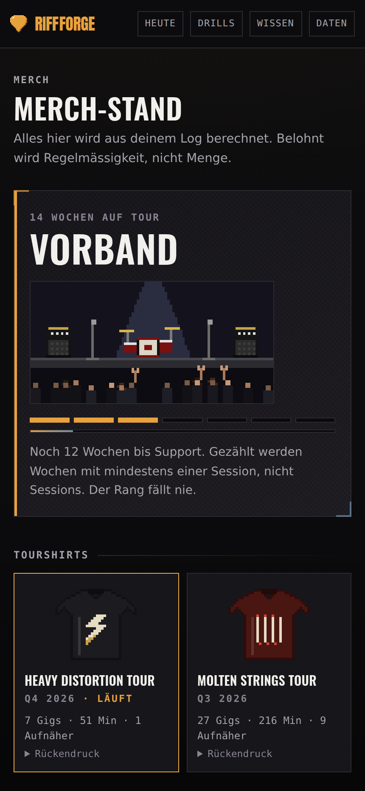
</p>

A little bit of game, borrowed from [Setlist](https://github.com/cyphomat/setlist) —
down to the design: headings as gaffa tape with marker, the shirt you can
turn round, the strip of rank pictures —
with the same guiding rule: **regularity and quality are rewarded, never
quantity.** Everything is computed from the log and stored nowhere; whoever
imports their data gets the same vest back. Reached through the rank line on
*Today*.

<p align="center"><sub>The stages, from the garage to the hall of fame — counted in weeks, not sessions</sub></p>

<table>
<tr>
<td align="center">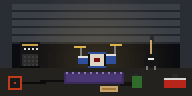<br><sub><b>Garagenband</b> · from week 0</sub></td>
<td align="center">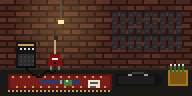<br><sub><b>Proberaum</b> · from 4 weeks</sub></td>
<td align="center">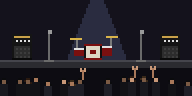<br><sub><b>Vorband</b> · from 12 weeks</sub></td>
<td align="center">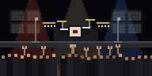<br><sub><b>Support</b> · from 26 weeks</sub></td>
</tr>
<tr>
<td align="center">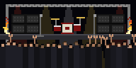<br><sub><b>Headliner</b> · from 52 weeks</sub></td>
<td align="center">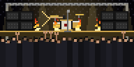<br><sub><b>Festival</b> · from 104 weeks</sub></td>
<td align="center">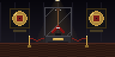<br><sub><b>Hall of Fame</b> · from 208 weeks</sub></td>
</tr>
</table>

- **The rank** — from garage band through rehearsal room, opening act, support,
  headliner and festival up to the hall of fame. It counts weeks with at least
  one session, not sessions: practising seven times in a week does not climb
  faster. **The rank never drops.**
- **The stage** — every rank has its own pixel scene, from the garage to the
  hall of fame; the current one sits at the merch stand and, small, on *Heute*.
  Below it the whole tour as a strip of pictures: what is behind you, where
  you stand, and what is still dark. Stages you have reached can be tapped —
  the old rehearsal room then fills the card again, with the day you got
  there.
- **The vest** — patches with the day they were earned, each ladder with its
  own embroidered motif. Each row shows only the
  next missing one as an outline, not a vest full of empty circles:

  | Row | Patches |
  |---|---|
  | Stage | Debut · 10 to 250 gigs (days, not blocks) · streaks from 4 to 52 weeks · comeback after a two-week break |
  | Craft | *Tight*, *Eingespielt*, *Wie aus einem Guss*: 10, 25, 50 days with only clean blocks · *On the dot*, *Im Raster*, *Studioreif*: 10, 50, 150 blocks with measured timing of 85 or better · *Target tempo*: one, three, ten drills clean at target |
  | Techniques | A shield per technique — *Stahlhand*, *Chug*, *Galopp*, *Wall of Sound*, *Blizzard* and six more: played clean on five different days. The next one is the one you are closest to, and it says how many days are missing |
  | Lead | *Guitar solo*: the first lick checked off · 10 and 25 licks |
  | Seven strings | *The Seventh* · *Low End* — only visible once you have practised on seven strings |
  | Knowledge | 10 to 100 cards that hold for a week · *Sense of time*: the first played question answered right |
  | Fretboard | 12, 36 and all 72 places that hold for a week when finding · *In- und auswendig*: all 72 when naming too |
  | Occasions | *Weihnachtsgig*, *Lemmy*, *Ozzy*: practised on a day of the occasion — only visible once earned, never as an outline |

- **Tour shirts** — every quarter with practice is a tour with a fixed name,
  and each hangs at the stand as a big pixel shirt. The colour comes from the
  first word of the name, the emblem from the second — *Molten Distortion Tour*
  is dark red with a lightning bolt, *Black Amps Tour* black with a cabinet.
  The front carries the print with Riffforge, emblem, tour name and quarter,
  and the running tour wears a *Live* sticker. **Rückseite zeigen** (show the
  back) turns the shirt round: on the back are the tour dates, as on any real
  tour shirt. Below, all dates fold out with what was played that day.
- **Festival shirts** — one for each rank from the rehearsal room on, long
  sleeve with a sleeve print: demo tape, microphone, backstage pass, spotlight,
  devil horns, gold record. The rank is the slowest thing in the app; a step up
  the ladder is worth something to wear.

<p align="center">
  
</p>

<table>
<tr>
<td align="center">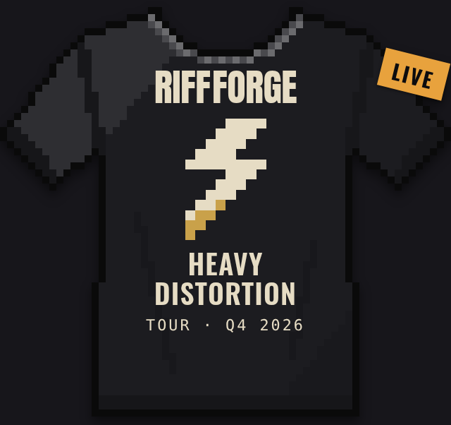<br><sub>Front: print and <i>Live</i> sticker</sub></td>
<td align="center">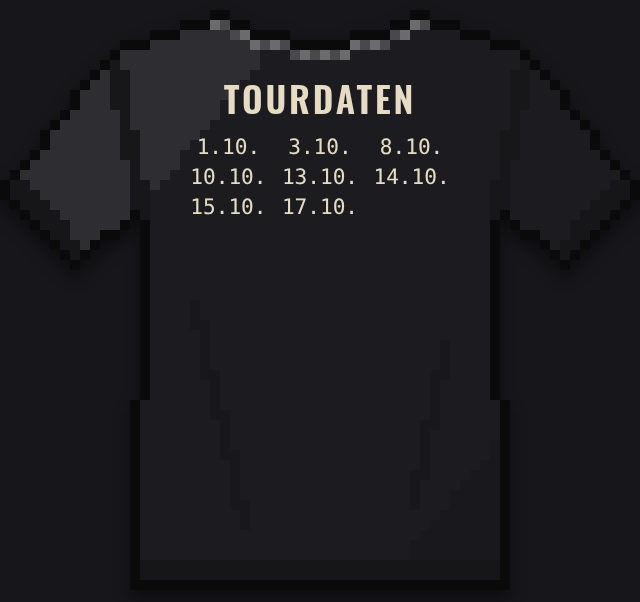<br><sub>Turned round: the tour dates</sub></td>
</tr>
</table>

When a session moves the rank up, the summary shows the new stage and the
festival shirt that comes with it. The technique shields are computed, not
drawn: the same sign as in the drill list, embroidered on cloth.

What the app cannot measure is not rewarded either: it does not know whether the
notes were right, so there is no patch for that. What a device lacks — a
seven-string — is missing from the vest instead of showing up as a failure.
After a session, newly earned patches appear right under the note.

## The look back

*Wo du stehst* shows your best value — a number that can only go up and so
says nothing about whether things are moving right now. The look back shows
the course of it, reached from the row under the rank on *Heute*:

- **The weeks** — practice days per calendar week as columns, the current one
  in amber, plus days, minutes and blocks against the week before. Weeks
  without practice show up as empty weeks; hiding a break would be
  flattering.
- **Per drill** — two lines side by side: the highest tempo rated *clean* or
  better that week, and the measured spread around the click (less is better).
  Two charts rather than one with two axes, because everyone reads two scales
  in one picture differently.
- **At the desk** — above them, borrowed from Roadie: one channel strip per
  drill. The fader sits at the latest clean tempo, the track runs from your
  own start tempo to the target — the same distance as the bar under *Wo du
  stehst*. A steel-blue notch marks where it stood at the start of the look
  back. A drill without a clean tempo gets no channel, rather than sitting at
  the bottom and claiming "start tempo".

It reaches back one quarter and grows with the log — three weeks of practice
show three weeks. What is not in the log is not here either: a week without a
clean tempo is a gap, not a zero, and without the microphone there is no
spread. Every chart also comes as a table.

## Knowledge

<p align="center">
  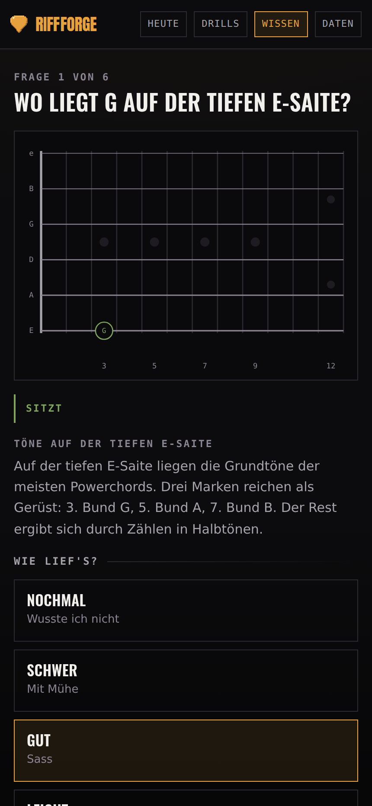
</p>

Fifteen minutes of playing and some theory go badly together if the theory is a
second screen to read. So here the **question is the normal state** and the text
is what comes after it: retrieval is measurably better for retention than
re-reading, and in music it is barely used.

A hundred and ninety-nine concepts across six levels — from the semitone to how riffs
are put together. Each with two or three sentences and a question:

- **Answer on the fretboard** where that is possible. Producing an answer beats
  picking one of four boxes, and the guitar is the instrument where theory can
  be shown rather than written down. The same note sits in several places: hit
  any of them and you are right.
- **After every answer the right one is shown**, with the sentence that explains
  why. Without feedback, the benefit of retrieval practice actually reverses at
  low success rates.
- **When something comes back** is decided by [FSRS-6](https://github.com/open-spaced-repetition/free-spaced-repetition-scheduler) —
  three numbers per card rather than a rule of thumb. Ported from the reference
  implementation and checked against 76 of its results, not reinvented.
- **Before the answer is revealed you say how sure you are** — guessed, fairly
  sure, sure. Sure and wrong, and the card comes straight back; *Wissen* shows
  how often your confidence held up. FSRS is untouched by it.
- **The transfer round asks scenarios instead of terms** — "the song turns minor,
  what do you change in the grip?" — across the levels, one question per level, in
  mixed order. It opens up once three cards of a level have been started.
- **Card state is replayed, not stored.** Answers are immutable; two devices
  merge their answers and arrive at the same state on their own.

Every technique a drill plays has cards — bending, legato, slides, tremolo,
alternate picking, dead notes. A test holds that in place: the first batch of a
session asks about what is about to be played, and without a matching card it
missed six techniques until October.

**CAGED** is its own series in level 4: the five open major shapes C, A, G, E
and D, moved up the neck until every chord sits under the hand wherever it is.
The questions are on the fretboard — where the root of a shape lies, where the
third, which shape comes next. The shapes are computed
(`lib/theory/caged.ts`), not typed in: the open chords plus a shift, checked in
all twelve keys. That also shows what links the shapes to the pentatonic: each
one sits entirely inside exactly one box of the minor pentatonic with the same
notes, G shape in box 1 through A shape in box 5 — the same mapping in every
key.

Alongside them, **triads on three strings**: major and minor in close
position, root position and both inversions, computed as well
(`lib/theory/dreiklaenge.ts`). On the G, B and high e strings each one is a
slice of a CAGED shape — on the low strings not always, so the card only
claims it there.

Notes are named the way tabs name them: the note above A is **B**. A German
sheet-music habit of typing **H** for it gets that explained rather than a bare
"wrong" — the right note was meant, just written in the other language.

### Inside a session

The questions do not wait on the knowledge screen; they arrive mid-practice, in
the transitions where the pick gets put down anyway — four of them, around
eighty seconds. The session does not grow because of
them, and nothing is blocked by them: **Überspringen, weiterspielen** is always
there, and the cards stay due. If nothing is due, the batch is skipped silently.

The first batch **primes**: it asks about the technique that comes up in the
next block. That is the link to what is being played — theory without it stays a
hobby of its own.

### A question you play

Seven cards do not ask for a term but for a figure: **play two bars of gallop.**
The microphone listens, and the verdict is measured rather than guessed — no
flashcard program can do that, and it falls out here because the onset detection
is already there.

Two bars of count-in first, one note per beat. That is where the signal chain's
delay is measured; only then does the figure count. Without that anchor it would
not work: a figure is uneven, and a delay in the order of its own spacing looks
like a *different* figure — measured, a reverse gallop shifted by 125 ms fits a
gallop to over eighty percent. On evenly spaced beats the delay is unambiguous.

Two things are counted: whether the attacks that were asked for arrived — and
whether *only* those did. Without the second number, mindlessly playing through
would pass every figure question, because a gallop's expected moments all sit on
the sixteenth-note grid. For the same reason there is no question asking for
sixteenths: they are the finest grid, every other figure is a subset of them,
and the question could be passed with almost anything.

A figure may also be longer than one beat. Three-note groupings — dotted
eighths — only land back on the beat after three of them; that question runs
three bars instead of two.

For one card, loudness counts as well: **dead notes** are indistinguishable from
straight sixteenths in time alone, the difference is entirely in how quiet the
muted attacks are. Measured, they still separate from the noise by a factor of
1.5 under heavy distortion. Accents do not — they stay between 1.15 and 1.24 and
sit inside that noise. So they are explained rather than measured.

Without a microphone nothing is blocked: the explanation can be shown anyway.
That counts as *not measured*, not as played wrong — at that point the app
simply knows too little to judge.

### A question you hear

Twenty-four cards ask the ear: the app plays two notes one after the other and
asks for the interval — every one from the minor second to the octave, up and
down. Ascending comes first, in an order that starts with the easy-to-tell
ones: octave, fifth, fourth, then the thirds.

The notes change every time a card is shown. The answer is the distance, and
that is what should be heard — not how the card sounded last time. They are
built from harmonics rather than recorded or modelled as a string, so the
pitch sits exactly where it should: measured with the same YIN the tuner uses,
within two cents across the whole range from A2 to E5.

### Learning the neck

Under *Griffbrett* — among the side paths on *Heute* and on *Wissen* — there is
a trainer of its own for what every bit of guitar theory takes for granted:
knowing where each note is. Two directions, because they are two skills:
**Ton finden** (F# on the A string — tap it) and **Ton benennen** (a spot
lights up — which note?). A round is twelve places, about two minutes, on one
string, on E and A, or on all of them.

Each of the seventy-two places is a card of its own in each direction, with
its own repetition from the same FSRS as the knowledge cards. What snags comes
back sooner; new places arrive in a sensible order, natural notes and low
frets first. Time counts too: under two and a half seconds a place is quick,
over six it is slow — whoever has to search does not quite know it yet, and a
slow answer comes back sooner than a quick one. The open string counts: E on
the E string is right open as well as at the 12th fret. A hit stays up for a
good two seconds, with the place, the time and a bar running down; tap it to
move on sooner. The
clock for the next question only starts once it is shown. Below the round, a map of the
neck shows what holds, what wobbles and what is still new.

The answers go into the same log as the knowledge questions, so they sync,
back up and delete like everything else. They do not count as knowledge
cards: not in the card count, not in the hit rate, and not for their patches —
the neck has a row of its own at the merch stand, and whatever a round earns
there shows up right in its report.

### Pedals and effects

Under *Wissen* there is a reference: **/wissen/effekte**, 24 entries from tuner
and wah through drives, gate, chorus and delay to power amp and cabinet. Each
entry says what the effect does, where you hear it in metal, what to start with
and what people get wrong the first time. Above all, **where it sits in the
chain**: the chain itself at the top in four stations (before the amp, preamp,
FX loop, power amp and cabinet), the entries below it, filterable by category.
Where the order is debatable, the exception is stated on the entry. It is
for looking things up, not for quizzing: the reference adds no cards and writes
nothing to the log.

## What the microphone hears

Switchable on in any block. It listens for **attacks, not pitches** — with a
distorted guitar, pitch tracking is unreliable while transients are unambiguous,
and for rhythm work the moment a note starts is the whole question anyway.

Two numbers that must not be confused:

| | |
|---|---|
| **Spread** | How even you are. **That** is the playing quality, and the score is built on it. |
| **Offset** | The constant distance from the click. Full of travel time — string → air → microphone → buffer. Does **not** count against you. |

The offset is estimated **before** matching. Without that step, Bluetooth
headphones (150–300 ms of latency) make every note miss its click, and the
measurement silently reads as "heard nothing".

A **negative** offset is not really a latency artefact: travel time can only
make a note later, never earlier. With one exception, and it was measured: with
dense clicks the offset is only known up to whole clicks. Eighths at 190 BPM are
158 ms apart; a chain with 80 ms of travel lands closer to the *previous* click
and read as "72 ms ahead" although the player was right on it. The score is not
affected, the statement is. So the app only says "you play ahead" when that is
unambiguous — and otherwise that calibrating would make it so.

### Calibration

Under **Daten → Mikrofon einmessen** the app measures this device's travel time
once and keeps it:

- **Through the speaker** — the microphone hears sixteen clicks and measures how
  long each one took. Pure machine, twenty seconds, nothing for you to do. Also
  valid for wired headphones, which hang off the same output.
- **With headphones** — for Bluetooth, where the microphone cannot hear the
  click: you strike a muted string on every click. Your own habit is then part
  of it, and the app measures against that afterwards.

Once calibrated, the app looks for the offset around the measured travel time
instead of around zero, and what is left over is your real position against the
click: *"Travel time taken out: you were 12 ms ahead of the click."* If a block
no longer fits the calibration — other headphones, another interface — it says
so rather than giving a wrong number. The calibration belongs to the device: it
goes neither into sync nor into the backup file, because the computer's travel
time would be wrong on the iPhone.

Afterwards it proposes the self-assessment itself. You can overrule it.

> **Use headphones.** Through speakers the microphone hears the metronome too
> and counts it as an attack.

Nothing is recorded and nothing is uploaded — only the moment of each attack is
evaluated.

## Tuning

The tuner sits on *Heute* next to *Ein Lick*, *Sieben Saiten* and *Griffbrett*, and the
seven-string mode offers *Erst stimmen* with B standard preselected. Strike a
string and let it ring: the needle shows cents, the lamp next to it *sitzt*
(in tune), *zu tief* or *zu hoch*, and a string counts as tuned once it stays
in tune for a moment.

Here the app hears **pitch** — with YIN, which looks for the period rather than
the loudest partial, because a distorted guitar puts more energy into the
octave than into the fundamental. Measured on synthetic plucked strings from B1
to E6: every single note right to the semitone, clean and high-gain alike, and
a tuned open string within two cents.

**In a block it still only judges the rhythm.** When the previous note of a lick
is still ringing, two notes go through the distortion together, and their
common period lies below both — YIN then lands an octave or a twelfth too low.
Measured: clean 98 % right, crunch 97 %, high-gain **70 %**. An app that says
"wrong note" on every third distorted note is lying; so it says nothing about
it. A test pins this limit down and turns red once it falls.

### Strings

Below the tuner the app keeps when the strings were last changed — one button,
*Heute neu aufgezogen* (put on new today), and it counts from there. Strings
die of playing more than of time: after **25 practice days** from the log, or
after **90 days** at the latest, *Heute* shows a line *Saiten · neue fällig*
(strings due). Before that it shows nothing. The date belongs to the device,
like the calibration — the guitar next to this computer, not the one at the
rehearsal room — and goes neither into sync nor into the backup file.

---

## Installing it as an app

<p align="center"></p>

**iPhone / iPad** — open it in **Safari** (Chrome on iOS cannot do this),
Share → *Add to Home Screen*.

**Mac** — Safari 17+: *File → Add to Dock*. In Chrome: the icon in the address
bar → *Install*.

It then starts without browser chrome, has its own icon — a skull with glowing eyes, in the
same pixels as the stages and patches — and **works offline** —
after the first visit everything is cached and a session needs no network.

Installing pays off for a less obvious reason too: Safari clears the storage of
ordinary websites after seven days without a visit. Home-screen apps are exempt
— so your practice log only survives if you actually install it.

### Three iOS quirks

- **The ringer switch has to be on.** iOS mutes Web Audio when the device is
  silenced — the metronome then stays quiet, with no error message. That is an
  iOS behaviour, not a fault of the app.
- **The app needs iOS 16.4 or newer.** The styling relies on CSS features
  Safari only gained with that release; on older devices the layout falls
  apart. Every iPhone from the 8 onwards gets 16.4.
- **The installed app has its own storage.** What lives in Safari — log,
  profile, a configured sync — is invisible to the app on the home screen, and
  the other way round. If you practised in the browser before, carry it over
  via *Daten → Sichern* and *Einlesen*, or set up the sync once inside the app.

## Data

Your practice log lives in `localStorage` on the device. No account, no server —
as long as you set nothing else up, nothing leaves the browser.

Under **Daten** you can pull it out as JSON and put it back in — the practice
log and the answered knowledge questions in one file. An import **adds rather
than replaces**: entries are immutable and carry a drill and a timestamp, so the
union of both sides is the right answer — two devices that practised
independently are both right. Before applying, the app shows how much of it is
actually new.

### Syncing between devices

The same screen can connect a **private data repository**. The app then also
writes the log there as a single file, and iPhone and Mac pull each other up to
date — automatically after every session, or by hand.

Neither side wins. On a write conflict it re-reads, merges again and writes once
more; the same union as on import. A sync with no news produces no commit.

Once a data repo is set up, sync sits at the top of **Daten** and counts as a
backup: the export reminder only returns once the last successful sync is two
weeks old as well.

Two files live there: `uebungen.json` and `theorie.json`. Separate for a
concrete reason — a device on an older build does not know a newer field, strips
it on read, and would write it away on the next sync. Two files cannot delete
each other.

What you need: a private repository (say `riffforge-data`) and a
**fine-grained** token that points at it alone, with *Contents: Read and write*.
Narrow for a concrete reason — every page under `github.io` shares one browser
storage, so a token that can open only one data repository limits the damage if
any of those pages ever has a hole.

If the data repository is public, the app says so clearly: it works exactly the
same, only everyone can read along.

### Version and updates

Under *Daten* you can see which build is running — commit and date — and whether
the server has a newer one. On a phone that is not a luxury: an installed PWA
keeps its shell in storage, and without this comparison nobody notices they have
been starting a weeks-old build. **Jetzt aktualisieren** clears the offline
storage and reloads; the practice log, the profile and the sync settings are
untouched.

The comparison needs no outside network: the build stamp sits next to the app as
`version.json`, and the same stamp is baked into the bundle. If they disagree,
the browser is holding an old build.

**If this is a fork**, the app says so — and offers to check how far the original
has moved on since. That single request goes to `api.github.com` and only on a
button press; the original's own deployment never makes it.

### Deleting means deleting

**Alles löschen** under *Daten* clears the log, any set-aside copy of it, the
answered knowledge questions, the two answers from the first launch — and a
configured sync including its token. The app is then back to freshly installed
in this browser; whatever sits in the data repository stays there. **Trennen**
removes only the account, repository and token from browser storage.

That nothing is left behind is a test, not an intention: it collects every
storage key that appears in the source and demands an empty storage afterwards.
The reason was a real bug — the token used to stay, and the next sync pulled
the deleted log straight back.

### What the app does not do

No analytics, no fonts from someone else's server, no embeds — measured, not
claimed: loading every page and playing a full session sends **not one request**
to any other host. `api.github.com` is the only foreign address at all, and even
that only twice: for syncing, if you set it up, and on a button press to check
the original — the latter only in a fork.

The microphone does not leave the machine: the audio thread reports **timestamps
and a level value**, nothing else. No audio is recorded, stored or sent, and the
capture is released again after every block. When tuning, pitch is added —
computed in the browser from the last 85 milliseconds, which are then
overwritten.

Since GitHub Pages serves no headers of its own, the Content Security Policy
sits in the page as a meta tag. The part that matters is `connect-src`: requests
may only go to the site itself and to GitHub. If foreign script ever got into
the page, it would have nowhere to send the token or the log.

### Supply chain

The site is built by GitHub Actions, and the build runs other people's code.
So every action is pinned to a fixed commit instead of a movable tag, and only
the deploy step may write to Pages, not the build. `pnpm audit` has to be
empty; a separate run checks that once a week, because new advisories don't
arrive with commits but with time. The one exception is recorded with its
reason in `package.json`: a bug in `braces` with no patched release, affecting
only the linter at build time — none of it reaches a visitor.

---

## Development

```bash
pnpm install
pnpm dev          # http://localhost:3000
```

```bash
pnpm test         # Vitest — the logic in lib/session and lib/audio
pnpm check        # types, tests and lint in one go
pnpm build        # static export to out/
```

The logic in `lib/session/`, `lib/audio/timing.ts` and `lib/sync/store.ts` is
pure: no React, no browser APIs. That is why it is testable, and that is why the
tests live there. New rules about tempo, selection or scoring belong there, not
in a component.

The microphone needs a secure context. `localhost` counts as secure, an IP on
your home network does **not** — so test on a phone through the published site,
not through `http://192.168.…`.

New screenshots for this page:

```bash
pnpm build && (cd out && python3 -m http.server 3100 &)
node tools/shots.mjs
```

The sign and the pictures on this page come from pixel grids, without a browser:

```bash
node tools/icons.mjs         # public/icons/ from assets/logo/totenkopf.txt
node tools/readme-bilder.mjs # banner, rank ladder, vest
```

Architecture and conventions are in [CLAUDE.md](./CLAUDE.md), the long rationales in
[docs/](./docs/) — both in German, like the code comments.

## Deployment

Push to `main` → GitHub Actions builds the static export and publishes it to
GitHub Pages ([`.github/workflows/pages.yml`](.github/workflows/pages.yml)). The
workflow lets nothing through that breaks `pnpm check`.

Pages serves from `/<repo>/`, which is why the workflow sets
`NEXT_PUBLIC_BASE_PATH`. Paths built at runtime — the audio worklet, the service
worker — have to go through `asset()` from `lib/base-path.ts`, or they reach
past the subdirectory.

## Content

All drills and riffs are **original** exercises in the idiom. No transcribed
tabs, no audio from copyrighted recordings.

## What is still coming

- **The iOS ringer switch.** There is a known trick for making Web Audio sound
  despite the mute switch. Untested, so not in yet.

## Contributing

Built by [@cyphomat](https://github.com/cyphomat). Found a bug, have a wish, an
idea for a drill? An [issue](https://github.com/cyphomat/riffforge/issues) is
welcome.

Riffforge is under the [MIT licence](./LICENSE): **forking, adapting and adding
your own drills is explicitly welcome.** A fork recognises the original by
itself and tells you under *Daten → Fassung* when there is something new.
Contributed drills follow the rule under *Content*: your own exercises in the
style, no copied tabs.

A practice tool, not a lesson, and without warranty. If your hand, wrist or
forearm hurts: stop.

## Thanks

The design language, the tone and the idea of the briefing come from
[Setlist](https://github.com/cyphomat/setlist) — the sister project, for
training. No neon: a tube amp glows, it does not beam.
